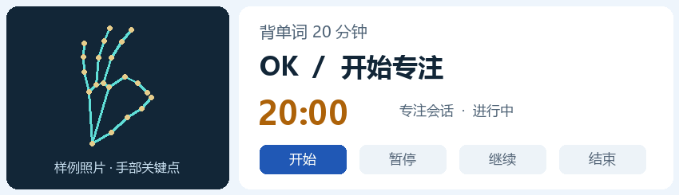
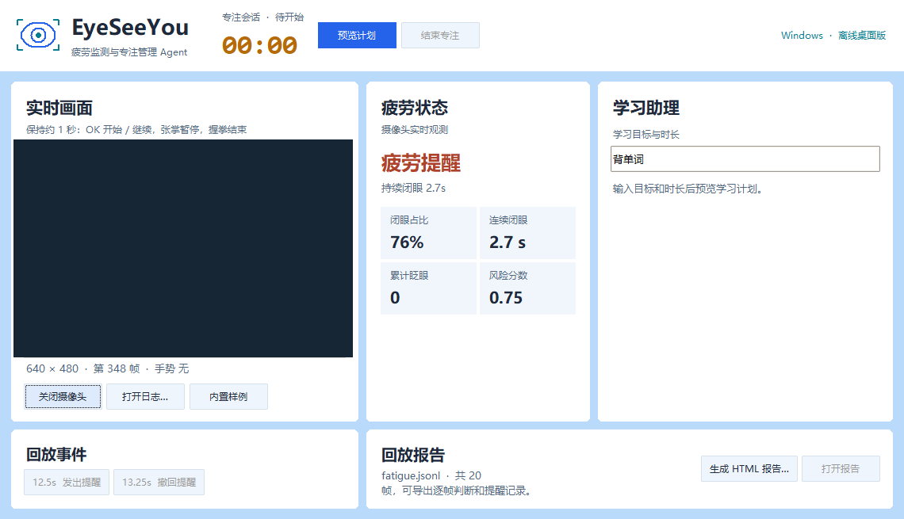
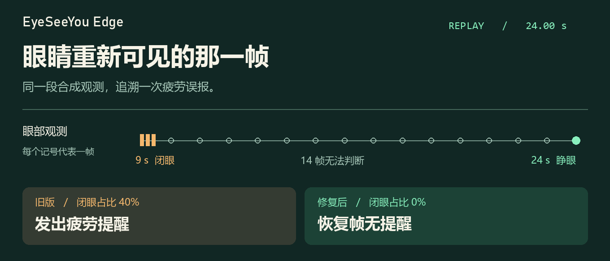

# EyeSeeYou 摄像头驱动的专注计时与疲劳提醒

EyeSeeYou 把团队 A210 开发板上的学习助手搬到了 Windows。打开电脑摄像头，用一个 OK 手势开始学习；持续闭眼时，界面会显示触发提醒的原因和时长。摄像头画面和关键点在本机内存中处理，学习进度保存在当前用户的电脑上。

**[下载 Windows x64 安装包 · v0.3.0（约 91 MiB）](https://github.com/skr99999/eyeseeyou-edge/releases/download/v0.3.0/EyeSeeYou-Edge-0.3.0-Windows-x64.msi)** · [版本说明与 SHA-256](https://github.com/skr99999/eyeseeyou-edge/releases/tag/v0.3.0) · [回归测试](https://github.com/skr99999/eyeseeyou-edge/actions/workflows/test.yml) · [MIT](LICENSE)

## 手机版

**[下载 Android APK](https://github.com/skr99999/eyeseeyou-edge/releases/download/v0.3.1-mobile/EyeSeeYou-Edge-0.3.0-Android.apk)** · [iPhone 网页自托管 ZIP](https://github.com/skr99999/eyeseeyou-edge/releases/download/v0.3.1-mobile/EyeSeeYou-Edge-v0.3.1-mobile-Web.zip) · [移动版说明与 SHA-256](https://github.com/skr99999/eyeseeyou-edge/releases/tag/v0.3.1-mobile)

1. 在 Android 手机上打开 APK 并按系统提示安装。最低 Android 8.0，建议先更新 Android System WebView。安装包自带本地模型，启动和视觉分析可以离线进行。
2. 首次打开会显示五步教学，也可以从上方的「使用教学」重看。先在「学习助理」输入目标和时长，点「预览计划」。
3. 点「开启摄像头」并允许相机访问。自然睁眼正视约 8 秒完成校准。校准后，连续闭眼达到 1.5 秒会显示提醒。
4. 一次放一只手，保持手势约 1 秒。**OK** 开始或继续，**张掌**暂停，**握拳**结束并保存。关闭摄像头后仍可手动计时和查看样例回放。画面和关键点在本机内存中处理，学习记录保存在应用内。

Android 15 模拟器验证了离线安装运行、拒绝相机权限后重试、相机关闭和退到后台释放、从旧版 APK 覆盖升级保留记录。注入样片验证了睁眼校准、OK 开始和握拳保存。张掌暂停与 OK 继续通过 Chromium 的样片测试，Android 模拟器尚未复现张掌暂停。手机实拍的疲劳判定仍待验证。

<details>
<summary>运行移动网页或构建 Android APK</summary>

在 Windows 上安装 Python 3.10+、JDK 17、Android SDK Platform 35 和 Build-Tools 35.0.0。在仓库根目录执行：

```powershell
./mobile/android/build.ps1 -SdkRoot <Android SDK 路径> -JavaHome <JDK 17 路径>
```

构建脚本从官方 npm 仓库和 Google 模型存储下载固定版本的资源，校验 SHA-256，然后打包、签名并核对 APK 内每个资源。产物在 `mobile/dist/`。首次在指定 SDK 目录生成本地测试签名，覆盖升级需要和旧版使用同一签名。该发布标签的 APK 内部版本是 `0.3.0`（`versionCode 302`）。

iPhone 可用 Safari 打开部署好的 HTTPS 页面，允许相机访问，再通过「分享」→「添加到主屏幕」建立入口。上方 ZIP 包含完整网页和模型，解压后可部署到受手机信任的 HTTPS 主机。

也可先运行 `python mobile/prepare_vision_assets.py`，再用 `python -m http.server 8765 --bind 127.0.0.1 --directory mobile/web` 在本机浏览器打开。通过手机浏览器运行同一网页时，需要部署到手机信任的 HTTPS 地址才能使用摄像头。

</details>

## 用自己的摄像头试一次

1. 双击 MSI 安装，从 Windows 开始菜单打开 **EyeSeeYou Edge**。安装包已包含 Python、图形界面和两个视觉模型，安装后可离线运行。
2. 在「学习助理」输入 **背单词 20 分钟**，点「预览计划」。再点左下方「开启摄像头」，正视镜头、自然睁眼约 **8 秒**，等中栏从「正在校准」变为「正常」。
3. 将一只手完整放入画面。拇指和食指成环、其余三指伸开，保持 **约 1 秒**。识别到 **OK** 后，20 分钟倒计时开始。**张掌**暂停，再做 **OK** 从剩余时间继续；**握拳**结束并保存。
4. 想试疲劳提醒，可以在校准后坐在镜头前闭眼约 **2 秒**。有效观测中的连续闭眼达到 1.5 秒会触发提醒，中栏显示原因。点「关闭摄像头」即可回到日志回放。



动图里的手形是从示例照片提取的关键点，时间和状态取自实际运行的桌面版。张掌暂停在 **19:58**，再次 OK 从 **19:58** 继续。样例来源：[OK 手势](https://commons.wikimedia.org/wiki/File:OK_Hand_Gesture_(cropped).jpg) · [张掌](https://storage.googleapis.com/mediapipe-assets/right_hands.jpg) · [握拳](https://storage.googleapis.com/mediapipe-assets/fist.jpg)。



这台测试电脑的内置摄像头以 **640 × 480** 运行。截图保留了第 348 帧的判定：**持续闭眼 2.7 秒**。照片区域已遮挡，使用软件时这里显示实时画面。

**没有摄像头也能试。** 启动后直接点内置回放里的「12.5s 发出提醒」和「13.25s 撤回提醒」，可以跳到对应帧，对照闭眼曲线和判断原因。自己的 JSONL 也可以在桌面预览并导出完整 HTML 报告。[查看回放界面](docs/windows-desktop.png)

<details>
<summary>从源码运行或构建 Windows 安装包</summary>

在 64 位 Windows 的 CPython 3.13 虚拟环境中，从仓库根目录运行：

```powershell
python -m pip install ".[camera]"
python windows/prepare_camera_models.py
python -m eyeseeyou_edge.desktop
```

构建安装包使用 `python -m pip install cx-Freeze==8.7.4` 和 `python windows/build_msi.py bdist_msi`，产物位于 `windows/dist/`。构建时校验两个模型的 SHA-256。会话数据保存在 `%LOCALAPPDATA%\EyeSeeYou Edge`。

</details>

## 从一段记录定位误报



**改一条规则，会让用户多收到哪一次提醒？** 运行 `python examples/check_alerts.py` 即可核对三段固定输入的全部提醒与撤回时间。另一个实验用五种采样率复现了“已经睁眼才开始提醒”的边界问题。[查看各版实测对照、复现命令和同类项目](docs/replay-evaluation.md)

## 复现图中的误报

在仓库根目录用 Python 3.10 或更高版本生成离线报告：

```sh
python -m eyeseeyou_edge examples/tracking_loss.jsonl --report tracking.html
```

双击打开 `tracking.html`。报告列出 23 帧，10 至 23 秒的眼部观测连续显示“无法判断”，第 24 秒恢复睁眼，整段发出提醒 0 次。选中“只看发出或撤回提醒的帧”可以筛选动作。换用 `examples/fatigue.jsonl` 便能看到一对提醒和撤回，分别出现在 12500 和 13250 毫秒。报告可离线转发，其中包括输入文件名、逐帧时间和判断结果。

需要逐行 JSON 输出时，直接运行：

```sh
python -m eyeseeyou_edge examples/tracking_loss.jsonl
```

看最后一行的 `t_ms=24000`。摄像头在第 10 至 23 秒每秒都送来一帧，但眼睛一直无法辨认。旧版把失去跟踪前后的 **5 个有效样本**拼成了一个足够长的窗口，其中 2 个被判闭眼，导致睁眼时反而发出提醒。现在，距离上一次有效眼部观测超过 1 秒就重建窗口。这一帧输出 `state="NORMAL"`、`perclos=0.0`、`action=null`。[原始输入](examples/tracking_loss.jsonl) · [修复前源码](https://github.com/skr99999/eyeseeyou-edge/tree/a543e174a959b70225dc04dd01142ccce0801164) · [回归测试和持续有效观测的对照组](tests/test_evidence_gap.py)

## 回放疲劳提醒与专注会话

下载本仓库 ZIP 后解压，或用 Git 克隆，在仓库根目录打开终端。需要 Python 3.10 或更高版本。运行依赖均在 Python 标准库内。

```sh
python -m eyeseeyou_edge examples/fatigue.jsonl
python -m eyeseeyou_edge.session "背单词 20 分钟"
python -m eyeseeyou_edge.session "背单词 20 分钟" --confirm
python -m examples.away_return
python -B -m unittest discover -s tests -v
```

在第一条命令的输出中，直接查找以下几个毫秒时间戳。输入只有 20 条合成观测，复现时无需摄像头、模型文件或云账号。

| 时间戳 | 可以验证什么 |
| ---: | --- |
| 8000 | 完成初始校准，进入 `NORMAL` |
| 9400 | 短闭眼记作一次眨眼，`alarm` 为 `false` |
| 10200 | 眼部分类不确定，`eye_sample_valid` 为 `false`，该帧不计入闭眼比例 |
| 12500 | 连续闭眼达到 1.5 秒，发出一次 `request_fatigue_alert` |
| 13250 | 睁眼得到确认，发出 `clear_fatigue_alert` |

第二条命令把 20 分钟分成词汇学习 7 分钟、回忆测试 10 分钟、错词复盘 3 分钟。第三条带上用户确认，原版专注状态机才会产生 `focus_started` 并进入 `RUNNING`。这个命令在内存 SQLite 中演示启动过程，关闭进程即结束。第四条把一次离席、回座和主动确认放进同一场会话，可以观察回座后什么时候恢复计时。

## 如何接自己的观测

在仓库根目录运行 `python -m pip install .` 后，其他 Python 项目可以直接逐帧读取判断结果。安装时 pip 会准备构建工具；包的运行依赖均来自标准库。也可以提前运行 `python -m pip wheel --no-deps -w dist .`，将生成的 wheel 带到另一台电脑离线安装。

```python
from eyeseeyou_edge.replay import replay

with open("observations.jsonl", "rb") as observations:
    for frame in replay(observations):
        if frame["action"]:
            print(frame["t_ms"], frame["action"])
```

将自己的观测文件命名为 `observations.jsonl`，或使用仓库的 `examples/fatigue.jsonl`。安装后用一条命令试跑[独立接入示例](examples/check_session.py)：

```sh
python -I examples/check_session.py examples/fatigue.jsonl
```

它汇总每次发出、撤回提醒的输入时间戳。在这份样例中各发生一次，分别是 12500 和 13250 毫秒。示例来自一次模拟第三方接入：开发者角色只阅读公开 README，在新虚拟环境中编写调用程序。

**错误处理。** Python 的 `replay()` 是惰性迭代器。遇到坏行时会抛出含行号的 `ValueError`，此前的帧可能已经交给调用方。需要整场统计时，请在迭代全部成功后再输出。独立示例演示了如何补上文件路径并返回退出码。

每行一个 UTF-8 JSON 对象，五个字段均为必填。下面是一帧有效观测，以及随后一次明确的缺面。完整可运行输入见 [合成样本](examples/fatigue.jsonl)。

```jsonl
{"t_ms":0,"face_found":true,"eye_state":"OPEN","ear":0.30,"mar":0.10}
{"t_ms":100,"face_found":false,"eye_state":"UNCERTAIN","ear":null,"mar":null}
```

- `t_ms` 是严格递增的非负整数毫秒。内部以首帧为时间原点。
- `eye_state` 可选 `OPEN`、`CLOSED`、`UNCERTAIN`。`ear` 和 `mar` 是眼睛、嘴部的纵横比。有脸时应为非负有限数，缺面时填 `null` 并将眼部状态标为 `UNCERTAIN`。
- 输入只接收这五个字段。有观测但未检测到人脸时，请显式记录缺面。相邻观测间隔超过 1 秒时，恢复首帧重新开始累计闭眼和张嘴时长，并重建闭眼占比窗口。间隔恰好 1 秒仍允许连续计时。采集端可按实际采样间隔设置 `fatigue.max_observation_gap_seconds`。
- 每行结果含判断理由 `reasons`、当前风险标志 `alarm` 和动作 `action`。命令行回放会打印这些判断。格式错误时，命令行指出文件、行号并以状态码 2 退出，之前的有效行已经输出。

运行 `python -m eyeseeyou_edge examples/camera_gap.jsonl` 可复现一次断流：9.0 秒和 9.2 秒观测到闭眼，下一帧在 12.5 秒到达。该帧的 `eye_closed_seconds` 为 0，`action` 为 `null`。

## 开源范围与复现

| 能力 | 本仓库提供的实现 |
| --- | --- |
| 疲劳判断 | 保留 A210 时间规则、校准和状态模型。缺面或断流会打断连续闭眼计时；持续失去有效眼部观测会重建闭眼占比窗口。字段 `perclos` 是滑窗中有效样本的闭眼占比，宜在稳定采样率下比较。 |
| 学习计划与行动 | 根据目标及时长在本地拆分子任务；校验确认后的计划，再交给专注状态机执行。可回放离席与恢复。 |
| 板端视觉与语言模型 | 暑期系统使用板端视觉推理和可选的外部语言服务。Windows 摄像头版使用本地 CPU 关键点模型。两条视觉路径共用疲劳时序规则，桌面计划使用本地模板。 |

### 怎样读这些结果

| 要核对的问题 | 可复现的结果 |
| --- | --- |
| 摄像头直接断流，恢复首帧会怎样？ | 相隔 3.3 秒后恢复，闭眼计时从 0 开始。持续收到闭眼观测后仍会在 1.5 秒触发提醒。[输入](examples/camera_gap.jsonl) · [续接帧与断言](tests/test_evidence_gap.py) |
| 排除了失效帧，会漏掉闭眼占比提醒吗？ | 对照序列每 200 毫秒采一帧，多次短闭眼始终低于长闭眼阈值。第 23 秒，闭眼占比规则独立触发提醒。[对照测试](tests/test_evidence_gap.py) |
| 回座会直接扣减剩余时间吗？ | 回座后保持 1169 秒，用户确认后恢复，下一秒才降到 1168 秒。[会话示例](examples/away_return.py) |

上述结果来自合成观测，验证从观测到动作的规则。真人使用时的误提醒次数、漏提醒次数、A210 现场帧率和功耗仍待实测。文献中也有按眼睑闭合**时间**和独立警觉性任务做对照的实验；复用这里的样本占比时，请同时记录采样间隔、无效帧和判定口径。[PERCLOS 原始实验](https://doi.org/10.1016/j.ijpsycho.2011.09.012)

首页把输入和动作放在同一条时间线上，参考了 [Rerun 的时间序列回放](https://github.com/rerun-io/rerun)。单独展示跟踪状态的做法可对照 [OpenFace 的输出字段](https://github.com/TadasBaltrusaitis/OpenFace/wiki/Output-Format)。按使用场景交代评测条件与局限的写法参考了 [Model Cards for Model Reporting](https://research.google/pubs/model-cards-for-model-reporting/)。

## 开发与许可

决策逻辑在 [fatigue.py](eyeseeyou_edge/fatigue.py) 和 [focus.py](eyeseeyou_edge/focus.py)，计划生成与确认在 [plan.py](eyeseeyou_edge/plan.py)。报告误提醒时，请给出最短的合成 JSONL、预期动作和实际输出，便于在测试中复现。

原项目由 EyeSeeYou 团队开发，成员见 [AUTHORS.txt](AUTHORS.txt)。源码沿用 [MIT License](LICENSE)。各模块与暑期版本的关系见 [来源与第三方说明](THIRD_PARTY_NOTICES.md)。
